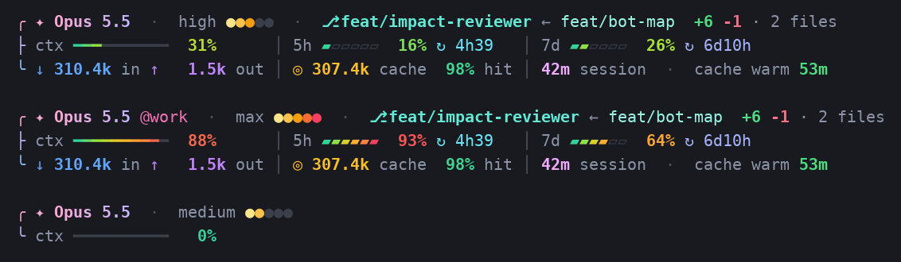

# custom-claude-glance

A colourful 3-line status line for [Claude Code](https://code.claude.com/docs/en/statusline): everything you want to know about your session, at a glance.



```
✦ Opus 5.5  ·  high ●●●○○  ·  ⎇ feat/impact-reviewer ← feat/bot-map  +6 -1 · 2 files
  ctx ━━━━━━━━━━  31%      │ 5h ▰▱▱▱▱▱  16% ↻ 4h39   │ 7d ▰▰▱▱▱▱  26% ↻ 6d10h
  ↓ 310.4k in ↑   1.5k out │ ◎ 307.4k cache  98% hit │ 42m session  ·  cache warm 53m
```

## What it shows

| Line | Item | Meaning |
|---|---|---|
| 1 | `✦ Opus 5.5` | Current model. A second account shows as `@work`, `@acc2`… (from `CLAUDE_CONFIG_DIR`) |
| | `high ●●●○○` | Reasoning effort (low → max) |
| | `⎇ branch ← base` | Git branch and the branch it was created from |
| | `+6 -1 · 2 files` | Uncommitted changes vs `HEAD`. **Ctrl/Cmd+click** opens the full diff |
| 2 | `ctx` | Context window used |
| | `5h` / `7d` | Subscription usage limits, with time until reset (`↻`) |
| 3 | `↓ in ↑ out` | Tokens in the context / last output |
| | `◎ cache · hit` | Tokens read from prompt cache, and session cache-hit ratio |
| | `cache warm 53m` | How long the prompt cache stays warm. Reply before it goes cold to save quota |

Bars and percentages turn green → yellow → red as they fill. Numbers use fixed widths so the columns never jump around.

## Install

You need **Python 3.8+** and **git** on your `PATH`. Nothing else.

Pick the line that matches what you want, paste it into a terminal, and press Enter.

### Windows (PowerShell)

Install for your Claude account (most people want this):

```powershell
irm https://raw.githubusercontent.com/trongld230289/custom-claude-glance/main/install.ps1 | iex
```

Install for **every** Claude account (`~/.claude` and all `~/.claude-*`):

```powershell
& ([scriptblock]::Create((irm https://raw.githubusercontent.com/trongld230289/custom-claude-glance/main/install.ps1))) -AllAccounts
```

Install for **one repo only**. First `cd` into the repo, then run:

```powershell
& ([scriptblock]::Create((irm https://raw.githubusercontent.com/trongld230289/custom-claude-glance/main/install.ps1))) -Project
```

Uninstall (restores the status line you had before):

```powershell
& ([scriptblock]::Create((irm https://raw.githubusercontent.com/trongld230289/custom-claude-glance/main/install.ps1))) -Uninstall
```

### macOS / Linux / Git Bash

Install for your Claude account (most people want this):

```bash
curl -fsSL https://raw.githubusercontent.com/trongld230289/custom-claude-glance/main/install.sh | bash
```

Install for **every** Claude account (`~/.claude` and all `~/.claude-*`):

```bash
curl -fsSL https://raw.githubusercontent.com/trongld230289/custom-claude-glance/main/install.sh | bash -s -- --all-accounts
```

Install for **one repo only**. First `cd` into the repo, then run:

```bash
curl -fsSL https://raw.githubusercontent.com/trongld230289/custom-claude-glance/main/install.sh | bash -s -- --project
```

Uninstall (restores the status line you had before):

```bash
curl -fsSL https://raw.githubusercontent.com/trongld230289/custom-claude-glance/main/install.sh | bash -s -- --uninstall
```

### After installing

Open a **new** Claude Code session and send one message. The status line appears after Claude's first reply.

To **update**, run the same install command again.

### What the installer changes

- **Account install** copies the script to `~/.claude/glance/glance.py` and sets `statusLine` in `~/.claude/settings.json`. Your other settings are kept, and any previous status line is saved so uninstall can restore it.
- **Repo install** writes to `.claude/settings.local.json` in that repo. That file is personal and not committed. It also adds `.claude/glance/` to `.git/info/exclude`, so the copied script never shows up in `git status`.
- **All accounts** is for people who run several accounts with `CLAUDE_CONFIG_DIR` (for example `~/.claude-work`). Every account points at the same script, and the account name appears next to the model.

### From a clone (optional)

If you cloned the repo, you can run the installers directly. The flags are the same as above:

| Goal | Windows | macOS / Linux |
|---|---|---|
| Your account | `.\install.ps1` | `./install.sh` |
| Every account | `.\install.ps1 -AllAccounts` | `./install.sh --all-accounts` |
| This repo | `.\install.ps1 -Project` | `./install.sh --project` |
| Another repo | `.\install.ps1 -Project -Path C:\code\app` | `./install.sh --project ~/code/app` |
| Uninstall | `.\install.ps1 -Uninstall` | `./install.sh --uninstall` |

## Troubleshooting

- **Nothing shows up:** the numbers arrive after Claude's first reply in a session. Run `claude --debug` to see script errors.
- **Colours look wrong:** use a truecolor terminal (Windows Terminal, VS Code, iTerm2, WezTerm…). The legacy Windows console does not support it.
- **`│` separators slightly crooked in VS Code:** set `terminal.integrated.gpuAcceleration` to `on`, so every glyph sits on the cell grid.
- **`⎇` shows as a box:** use a font that has it, such as Cascadia Code or any Nerd Font.
- **Ctrl+click on `+6 -1` does nothing:** set `FORCE_HYPERLINK=1` in your environment (`setx FORCE_HYPERLINK 1` on Windows), then restart the terminal.

## Customise

`glance.py` is a single, commented file. Colours live at the top (`HEAT`, `MUTED`…), and each line is built in its own section at the bottom. Edit the installed copy, or fork the repo.

---

### Tiếng Việt

Status line 3 dòng cho Claude Code: model, effort, branch (kèm nhánh gốc), số dòng thay đổi, context, quota 5h/7d kèm giờ reset, token, tỉ lệ cache hit và thời gian cache còn "ấm".

Cần có **Python 3.8+** và **git**. Chọn đúng một lệnh, dán vào terminal rồi Enter.

**Windows (PowerShell)**

| Muốn làm gì | Lệnh |
|---|---|
| Cài cho tài khoản Claude đang dùng | `irm https://raw.githubusercontent.com/trongld230289/custom-claude-glance/main/install.ps1 \| iex` |
| Cài cho mọi tài khoản | `& ([scriptblock]::Create((irm https://raw.githubusercontent.com/trongld230289/custom-claude-glance/main/install.ps1))) -AllAccounts` |
| Chỉ cài cho repo hiện tại (cd vào repo trước) | `& ([scriptblock]::Create((irm https://raw.githubusercontent.com/trongld230289/custom-claude-glance/main/install.ps1))) -Project` |
| Gỡ cài đặt | `& ([scriptblock]::Create((irm https://raw.githubusercontent.com/trongld230289/custom-claude-glance/main/install.ps1))) -Uninstall` |

**macOS / Linux / Git Bash**

| Muốn làm gì | Lệnh |
|---|---|
| Cài cho tài khoản Claude đang dùng | `curl -fsSL https://raw.githubusercontent.com/trongld230289/custom-claude-glance/main/install.sh \| bash` |
| Cài cho mọi tài khoản | `curl -fsSL https://raw.githubusercontent.com/trongld230289/custom-claude-glance/main/install.sh \| bash -s -- --all-accounts` |
| Chỉ cài cho repo hiện tại (cd vào repo trước) | `curl -fsSL https://raw.githubusercontent.com/trongld230289/custom-claude-glance/main/install.sh \| bash -s -- --project` |
| Gỡ cài đặt | `curl -fsSL https://raw.githubusercontent.com/trongld230289/custom-claude-glance/main/install.sh \| bash -s -- --uninstall` |

Cài xong, mở một phiên Claude Code **mới** và gửi một tin nhắn, status line sẽ hiện sau câu trả lời đầu tiên. Muốn cập nhật thì chạy lại đúng lệnh cài.

## License

MIT
